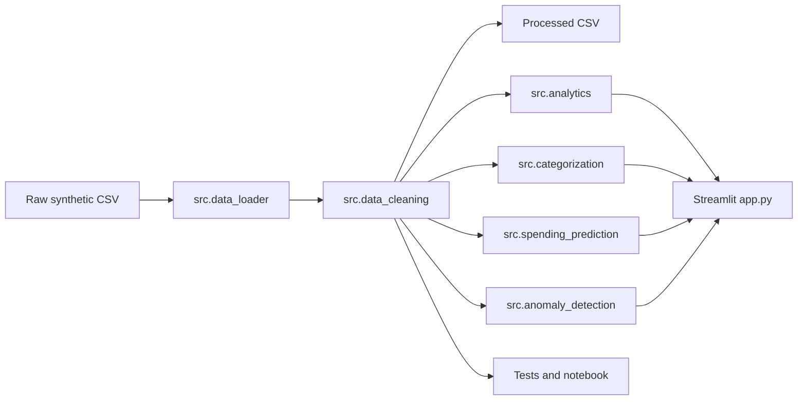

# Smart Expense & Spending Analyzer

A local Python and Streamlit application for validating, exploring, and forecasting a user-supplied expense CSV. The bundled synthetic dataset remains only as a development fixture and is not displayed by default.

The project demonstrates an end-to-end analytics pipeline:

```text
Raw CSV -> Data Validation -> Data Cleaning -> Exploratory Analytics -> ML Baselines -> Streamlit Dashboard -> Tests
```

## Problem Statement

Personal transaction exports are often messy: repeated rows, inconsistent descriptions, mixed transaction types, and occasional unusual values. This project turns a small synthetic CSV into a reproducible analysis workflow with clear cleaning decisions, spending summaries, baseline machine learning, and a local dashboard.

## Objectives

- Preserve the raw synthetic CSV unchanged.
- Validate required columns and data types with clear errors.
- Clean exact duplicate rows and reject invalid records deliberately.
- Separate income from expenses for all financial calculations.
- Provide reusable analytics functions and a Streamlit dashboard.
- Train baseline ML models without leaking target labels into features.
- Test the core behavior with deterministic fixtures.

## Features

- Upload-first CSV workflow with reviewable date, amount, description, category, transaction-type, and payment-method mappings.
- CSV validation for unusable dates, invalid amounts, exact duplicate rows, and currency-formatted values.
- Date parsing, amount conversion, duplicate checks, category/type/currency validation.
- Cleaned output at `data/processed/transactions_clean.csv`.
- KPI calculations for expenses, income, net cash flow, transaction count, average and highest expenses.
- Daily, weekly, and monthly spending summaries.
- Category, payment-method, income-vs-expense, and top-description analysis.
- TF-IDF plus Logistic Regression transaction-category classifier.
- Chronological monthly expense forecast with a previous-month baseline comparison.
- Isolation Forest anomaly detection for expense transactions.
- Streamlit dashboard with upload, date/category/type/payment filters, data table search, CSV download, ML insights, and data-quality summary.
- Pytest coverage for cleaning, analytics, model behavior, invalid inputs, and empty datasets.

## Architecture



## Project Structure

```text
Expense_Tracker_and_Predictor/
├── app.py
├── explore_data.py
├── requirements.txt
├── README.md
├── README_DATASET.md
├── data/
│   ├── raw/synthetic_transactions.csv
│   └── processed/transactions_clean.csv
├── models/
├── notebooks/01_exploratory_analysis.ipynb
├── reports/
├── src/
│   ├── data_loader.py
│   ├── data_cleaning.py
│   ├── analytics.py
│   ├── categorization.py
│   ├── spending_prediction.py
│   └── anomaly_detection.py
└── tests/
```

## Setup on Windows PowerShell

From the workspace root:

```powershell
python -m venv .venv
.\.venv\Scripts\Activate.ps1
cd smart_expense_analyzer_starter
python -m pip install -r requirements.txt
```

If `.venv` already exists, activate and reuse it.

## Usage

Run the exploratory snapshot:

```powershell
python explore_data.py
```

Run tests:

```powershell
python -m pytest
```

Launch the dashboard, then upload your Kaggle CSV in the sidebar and confirm the suggested column mappings:

```powershell
python -m streamlit run app.py
```

## Dataset

The dataset is synthetic and located at `data/raw/synthetic_transactions.csv`.

- Raw rows: 1,776
- Columns: 9
- Date coverage: January 2025 through June 2026
- Currency: INR
- Categories: Food, Transport, Groceries, Education, Shopping, Entertainment, Bills, Health, Income

It contains deliberate duplicate rows, inconsistent descriptions, and unusually large synthetic expenses. It is used for automated tests and must not be treated as real personal finance data. The dashboard itself begins empty and analyses only the CSV you upload.

## Data Cleaning Methodology

The cleaning pipeline:

- Validates required columns before processing.
- Removes exact duplicate rows, because the synthetic dataset deliberately includes duplicates for cleaning practice.
- Reports repeated transaction IDs separately instead of assuming every repeated ID is safe to drop.
- Parses `date` with invalid values rejected.
- Converts `amount` to numeric values and rejects invalid or non-positive amounts.
- Validates transaction types, categories, and INR currency.
- Normalizes description whitespace without removing merchant-specific text.
- Sorts valid rows chronologically.
- Saves cleaned data to `data/processed/transactions_clean.csv`.

## Analytics Methodology

All financial analytics use explicit `transaction_type` filtering. If an uploaded file does not provide income/debit-credit information, the dashboard shows total expenses only and deliberately marks income and net cash flow as unavailable. It never assumes that expense-only data implies a negative balance.

When both income and expense transaction types are available, net cash flow is calculated as:

```text
income - expenses
```

Income is never included in expense totals.

## ML Methodology

### Transaction Categorization

The category model uses only transaction descriptions as input:

- TF-IDF text features
- Logistic Regression classifier
- Stratified train/test split
- Fixed random seed
- Accuracy, weighted precision, weighted recall, weighted F1, and confusion matrix

The `category`, `transaction_type`, and `is_anomaly_synthetic` columns are not used as input features.

### Monthly Spending Forecast

Monthly expenses are aggregated chronologically. The forecast model uses lagged spending and simple calendar/time features, evaluated on a chronological holdout and compared with a previous-month spending baseline.

Because the dataset contains only 18 calendar months, the forecast is a portfolio baseline, not a reliable real-world personal-finance predictor.

### Anomaly Detection

Anomaly detection uses expense rows only. It uses amount, day/month features, and category indicators with Isolation Forest. The synthetic anomaly marker is not used as a model feature.

An anomaly means an unusual observation, not proof of fraud or data error.

## Actual Results

Results from the latest validation run are recorded in `reports/metrics_summary.json`.

- Cleaning: 1,776 input rows, 10 exact duplicates removed, 0 rejected rows, and 1,766 cleaned rows.
- Category model: accuracy 1.000, weighted precision 1.000, weighted recall 1.000, and weighted F1 1.000 on a 442-row test split. These unusually strong results are expected to be optimistic because recurring synthetic merchant descriptions appear across the split.
- Forecast: model MAE 21,468.85 and RMSE 25,839.16; previous-month baseline MAE 32,771.16 and RMSE 37,622.79. The next-month baseline estimate is INR 114,681.80 for July 2026.
- Tests: 14 passed with `python -m pytest -q`.

## Screenshots

Launch the Streamlit app and capture screenshots locally:

```powershell
python -m streamlit run app.py
```

Suggested views: Overview KPIs, Spending Analytics, Transaction Explorer, ML Insights, and Data Quality.

## Testing

The tests use small deterministic fixtures and cover:

- CSV loading and schema validation
- Date and amount conversion
- Duplicate and invalid row handling
- Missing/empty dataset behavior
- Income and expense separation
- Total expense and net cash-flow calculations
- Monthly aggregation
- Category model pipeline
- Forecast behavior with insufficient history
- Anomaly detection on valid inputs

## Known Limitations

- The dataset is synthetic and small.
- Repeated merchant names can make category-classification metrics optimistic.
- Forecasting has limited history and should be interpreted cautiously.
- Isolation Forest flags unusual transactions but cannot determine intent or fraud.
- The app is local-only and does not include authentication or database storage.

## Future Improvements

- Add richer merchant normalization.
- Add walk-forward forecasting evaluation.
- Add saved chart exports.
- Add optional notebook execution in CI.
- Add user-provided category mapping rules.

## Ethical and Privacy Considerations

Do not upload real bank statements or personal financial information to public repositories. If adapting this project for real data, anonymize descriptions, account identifiers, locations, and transaction metadata before sharing.

